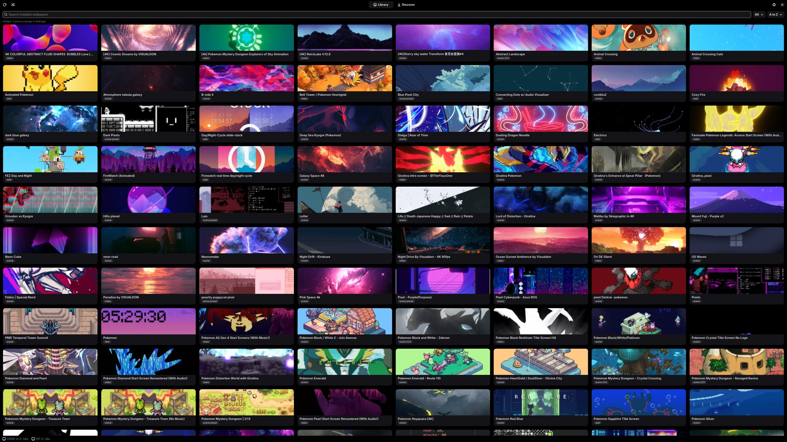
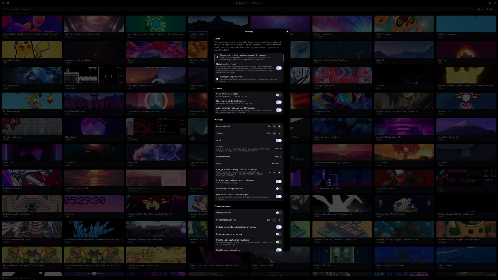

<p align="center"></p>

<h3 align="center">Your Wallpaper Engine library, running natively on Wayland.<br>One small Rust renderer. No Wine, no second engine.</h3>

<p align="center">
  <a href="https://github.com/pgm1207/WallForge/actions/workflows/ci.yml"></a>
  <a href="https://github.com/pgm1207/WallForge/releases/latest"></a>
  
  <a href="https://pgm1207.github.io/WallForge/"></a>
  
</p>

<p align="center"></p>

<p align="center"><sub>Recorded from the renderer: a Wallpaper Engine scene with a multi-pass fluid simulation, no post-processing.<br>
<a href="https://github.com/pgm1207/WallForge/releases/download/v0.7.0/demo.mp4">Same clip as video (mp4, 5 s)</a></sub></p>

**WallForge** is a GTK4 / libadwaita app *and* the renderer behind it. It plays the
[Wallpaper Engine](https://store.steampowered.com/app/431960/) wallpapers you already own on any Wayland desktop with
layer-shell support, and it manages them: search, per-wallpaper settings, audio, rotation, palette sync.

```bash
# Arch / CachyOS: install the package, then run it
sudo tee /etc/pacman.d/wallforge.conf >/dev/null <<'EOF'
[wallforge]
SigLevel = Optional
Server = https://pgm1207.github.io/WallForge/arch/x86_64
EOF
grep -q wallforge.conf /etc/pacman.conf || echo 'Include = /etc/pacman.d/wallforge.conf' | sudo tee -a /etc/pacman.conf
sudo pacman -Sy wallforge && wallforge
```

Everywhere else, [build from source](#from-source): it takes about a minute of compiling. You need to own Wallpaper
Engine on Steam for the Workshop library and its shared assets; WallForge never ships or redistributes its files.

**Contents** · [Why](#why-wallforge) · [What it plays](#what-it-plays) · [Screenshots](#screenshots) ·
[Performance](#performance) · [Rotation](#rotation) · [Features](#features) · [Install](#install) ·
[FAQ](#faq) · [Roadmap](#roadmap) · [Troubleshooting](#when-a-wallpaper-looks-wrong) · [Documentation](#more-documentation)

## Why WallForge

| | |
|---|---|
| **One app, not a pile** | Library, settings, Discover, share links and the renderer in a single GTK4 window. Nothing else to install or configure. |
| **Light by design** | One small Rust process per screen, speaking Wayland and GLES directly. A still scene is drawn once and then sleeps; a 4K video wallpaper costs about 1% of one CPU core. |
| **Looks right by default** | Auto fit fills the screen (ultrawide art is cropped) and keeps portrait art whole. No stretched wallpapers. |
| **Brings your setup along** | Imports your Wallpaper Engine `config.json`: per-wallpaper properties, volumes, frame rate limit, fullscreen rule. |
| **Plays the hard ones** | Multi-pass effects, layer render targets, particles, embedded video, text with glow/outline, audio-reactive visualisers. |
| **Fits your desktop** | Palette sync with Noctalia, matugen, wallust or pywal; per-monitor wallpapers; rotation; restore at login; battery saving. |

## What it plays

Every scene wallpaper in our test library (77 installed Workshop scenes) starts with nothing skipped, except one 3D
scene, which WallForge detects and refuses instead of showing a black screen. The full matrix, including what is
still approximate, is in [docs/compatibility.md](docs/compatibility.md).

| Wallpaper type | Status |
|---|---|
| Video | Hardware decode (VAAPI, zero-copy DMA-BUF), audio, gapless loop, volume and mute. |
| Scene (2D) | Layers, multi-pass effects, render-target sampling, particles, embedded video, text layers, property edits. SceneScript is not executed. |
| Web | WebKit on the wallpaper layer, with the wallpaper's properties. |
| 3D scenes | Not supported; detected before you apply one. |

## Screenshots

<table>
<tr>
<td width="50%"></td>
<td width="50%"></td>
</tr>
<tr>
<td align="center"><sub>Library: everything you subscribed to, with search, filters and favourites</sub></td>
<td align="center"><sub>Settings: setup status at a glance, then playback, rotation, power and desktop</sub></td>
</tr>
</table>

## Performance

Measured on a Ryzen 9 9900X with a Radeon RX 9070 (RADV), 3840×2160 output, default 30 fps, one wallpaper.
`tools/bench.sh <workshop-id>` reproduces the whole table on your own machine, including the idle GPU baseline.

| Wallpaper | CPU (one core) | GPU | Process RSS | Scene textures |
|---|---|---|---|---|
| 4K video, hardware decoded | ~1% | ~5% (idle desktop is ~3%) | 135 MB | — |
| Static scene | ~0% | drawn once, then sleeps | 107 MB | 32 MB |
| Fluid-simulation scene (19 effect passes) | ~2% | ~14% | 124 MB | 142 MB |

Settings that trade a little sharpness for a lot less GPU time:

- **Render resolution (%)**: scene wallpapers are drawn at 25–100% of the screen size and upscaled with linear
  filtering. Videos and web wallpapers always play at native resolution. 100% is the default; 75% is a good
  compromise on a laptop or a shared GPU, 50% makes a heavy scene comfortable on an integrated GPU.
- **Frame rate limit**: 30 fps by default (5–240). 24 is enough for most wallpapers and nearly halves the work of 60.
- **Disable particles**, **Disable parallax**, **Disable mouse interaction**: turn off the effects that cost the most
  and that you are least likely to notice under your windows.
- **Reduce frame rate and resolution on battery**: while discharging, the limit drops to 30 fps and the render scale to
  75% at most, without touching your settings.
- **Preload the next wallpaper**: the next pick (rotation, Ctrl+Shift+N) is loaded behind the current one, so the
  switch is one frame (~30 ms) instead of a load. It costs that wallpaper's memory while it waits; turn it off if your
  GPU is short on memory.
- **Pause wallpapers on battery**: stops every wallpaper while discharging and brings them back when you plug in.

If a wallpaper stops on its own, WallForge restarts it; after three failures in five minutes it leaves the screen idle
and says so in the playing bar instead of looping on a crash.

## Rotation

Settings > Playback > **Change wallpaper every** switches to a new wallpaper every N minutes (0 turns it off).
*Pick a random wallpaper* chooses at random; with it off, the library order is followed. *Rotate only through
favourites* keeps the rotation to wallpapers you starred. *Give each screen its own wallpaper* rotates each monitor
independently, so two screens get two different wallpapers; with it off they all change to the same one. Rotation
waits while wallpapers are paused by battery saving, never picks a wallpaper that is already showing, and leaves
screens you stopped by hand stopped. **Ctrl+Shift+N** switches now without waiting for the timer.

While rotation is on, closing the window keeps WallForge running in the background so the timer keeps working; open it
again from the menu (or your launcher) and it comes straight back. **Ctrl+Q** quits for good.

## Features

- **Library** of everything you subscribed to, with search, type filter, sort, favourites and a random button.
- **Every property type** is editable per wallpaper (sliders, colours, combos, text, image slots) and applies live.
- **Volume per wallpaper**, on top of the global volume and mute.
- **Discover tab** browses the Steam Workshop, with one-click Get through your running Steam client
  (experimental: if the click fails, Steam opens the page for you).
- **Share and open links**: copy any wallpaper's Workshop link, or paste one into Discover.
- **Import from Wallpaper Engine**: your customised wallpaper settings, volumes and playback rules.
- **Per monitor**: apply to one screen or all. Ultrawide wallpapers are cropped to fill 16:9 screens, or skipped if you prefer.
- **Auto scaling** by default; fill, fit and stretch are in Settings.
- **Palette sync** with Noctalia, matugen, wallust, pywal or a custom command.
- **Restore at login**: `wallforge --restore` re-applies your saved wallpapers (toggle in Settings).
- **Audio-reactive wallpapers** hear what you play: visualisers and spectrum effects are driven by the system's audio
  output, with no microphone involved, and stay idle when no wallpaper asks for them.
- **Safe**: a crash shows a toast with a "View log" button, a dead renderer is restarted automatically, broken files
  are caught by a watchdog, and unsupported 3D scenes are detected before you apply them.
- **Sensible defaults**: anime and mature content are hidden until you switch them on in Settings.

Keyboard: `Ctrl+F` search · `Ctrl+R` random wallpaper · `Ctrl+Shift+N` rotate now · `Ctrl+,` settings · `F5` rescan ·
`Esc` hide the sidebar · `Ctrl+Q` quit (including from the background).

## Install

### What you need

- A Wayland desktop. X11 is not supported.

  | Desktop | How it draws | Tested |
  |---|---|---|
  | niri, Hyprland, Sway, river, Wayfire, labwc | `wlr-layer-shell` | niri |
  | KDE Plasma 6.7+ | `wlr-layer-shell` (KWin implements it from that release) | KWin 6.8 |
  | GNOME 45+ | the bundled GNOME Shell extension (Settings > Setup > Install GNOME extension, or `install.sh`; log out and in once) | GNOME Shell 51, video wallpapers, headless |

  On GNOME, web wallpapers are not supported yet (the web player needs layer-shell), and the extension was not tested
  on GNOME 45 to 50.
- Python 3.11+, GTK 4, libadwaita 1.5+, PyGObject, Pillow, aiohttp, ffmpeg. For the renderer: Rust, clang, libva and
  EGL. For web wallpapers: `webkitgtk-6.0` and `gtk4-layer-shell`.
- Steam, signed in to an account that owns Wallpaper Engine, to download Workshop wallpapers. Scene wallpapers also
  need Wallpaper Engine's shared `assets/` folder, which WallForge never ships —
  [here is how to get it](#wallpaper-engines-assets).

Run `wallforge --doctor` at any time (or `./wallforge.sh --doctor` from a source checkout) to check all of the above
on your machine and print what to fix.

### Arch binary repository

Every release is packaged and published to a pacman repository, so Arch and CachyOS install and update it with
pacman:

```bash
sudo tee /etc/pacman.d/wallforge.conf >/dev/null <<'EOF'
[wallforge]
SigLevel = Optional
Server = https://pgm1207.github.io/WallForge/arch/x86_64
EOF
grep -q wallforge.conf /etc/pacman.conf || echo 'Include = /etc/pacman.d/wallforge.conf' | sudo tee -a /etc/pacman.conf
sudo pacman -Sy wallforge
```

Those packages are unsigned and the repository sets `SigLevel = Optional`; if you sign your own repositories, build
from source instead. What is published, and how it is built, is in [`packaging/arch-repo/`](packaging/arch-repo).

### AUR

A `wallforge-git` PKGBUILD is in [`packaging/aur/`](packaging/aur). It is not on the AUR yet (the AUR pauses new
registrations from time to time); build it with `makepkg -si` from that folder in the meantime.

### From source

```bash
# Arch / CachyOS
sudo pacman -S python-gobject gtk4 libadwaita python-pillow python-aiohttp ffmpeg libva rust clang \
               webkitgtk-6.0 gtk4-layer-shell
git clone https://github.com/pgm1207/WallForge
cd WallForge
./install.sh        # builds the renderer (about a minute), adds a menu entry and icon
./wallforge.sh
```

`install.sh` installs into `~/.local/opt/wallforge` and links a launcher; the checkout stays the source of truth, so
`--restore` and updates keep working.

On other distributions, install the same pieces from your package manager:

| Distribution | Packages |
|---|---|
| Fedora | `python3-gobject gtk4 libadwaita python3-pillow python3-aiohttp ffmpeg-free rust cargo clang libva-devel mesa-libEGL webkitgtk6.0 gtk4-layer-shell` |
| Debian 13+ / recent Ubuntu | `python3-gi gir1.2-gtk-4.0 gir1.2-adw-1 python3-pil python3-aiohttp ffmpeg cargo clang libva-dev libegl1`, plus `libgtk4-layer-shell0 gir1.2-gtk4layershell-1.0` for web wallpapers |

Names drift between releases and only the Arch list is exercised in CI, so run `wallforge --doctor` afterwards: it
names whichever piece is missing instead of making you guess.

## Share a wallpaper

Select a wallpaper and press the **share button** in its panel (next to the favourite star). The link to its Steam
Workshop page is copied to the clipboard, and the toast offers to open the page. Discover cards have the same button.

To open a link someone sent you, paste it into the **Discover** search box and press Enter. If you already have the
wallpaper it opens in your library; otherwise its card appears with a Get button. A bare Workshop id works too.

Only wallpapers that are on the Workshop have a link. The button is greyed out for local projects.

## Import your Wallpaper Engine settings

**Settings > Wallpaper Engine > Import settings** reads the `config.json` that Wallpaper Engine keeps in its install
folder (`steamapps/common/wallpaper_engine/config.json`). If you used Wallpaper Engine on Windows, pick the file from
your Windows drive with **Choose file**. You see what would change before anything is written.

| Imported | Not imported |
|---|---|
| Each wallpaper's customised properties (colours, sliders, switches, combos, text) | Playlists |
| Each wallpaper's volume | Per-wallpaper alignment, playback speed and colour adjustments |
| Frame rate limit | Image and file properties (they point at Windows paths) |
| The fullscreen pause rule | Settings of wallpapers that are not installed here |
| Optionally, the wallpaper that was active | |

From a terminal: `wallforge --import-we [path/to/config.json] [--dry-run]`.
Details are in [docs/wallpaper-engine-import.md](docs/wallpaper-engine-import.md).

## Wallpaper Engine's assets

You do not need Wallpaper Engine installed, but you do need to own it. Scene wallpapers need its `assets/` folder
(shaders and textures), which WallForge never ships. Video and web wallpapers do not need it. Use either:

1. **Fetch from Steam (about 85 MB).** Settings > Setup > **Fetch assets from Steam** opens a terminal where you sign
   in to Steam with [DepotDownloader](https://github.com/SteamRE/DepotDownloader) (pinned release, checksum verified).
   Your password goes to DepotDownloader only, never to WallForge. An account that does not own Wallpaper Engine is
   refused by Steam.
2. **Install it in Steam** (about 0.8 GB). WallForge uses its `assets/` folder directly.

Workshop wallpapers themselves are downloaded by the Steam client when you subscribe.

## Other sources

Wallpapers do not have to come from the Workshop. Click **+** in the header (or run `wallforge --import PATH`) and pick:

- **Video or GIF** (mp4, webm, mkv, mov, gif): the file is *linked*, not copied, so big videos use no extra disk. If you move or delete the original, the item shows as broken; use `--copy` to keep a copy instead.
- **Image**: shown as a full-screen page.
- **HTML folder** (or an `index.html`): copied in as a web wallpaper.
- **Lively `.zip`**: video, GIF, web and picture packages work. Lively app, Unity, Godot, URL and BizHawk wallpapers are refused with a message.

Items live in `~/.local/share/wallforge/library/local-*/` with a normal `project.json`, show up in the grid (filter **Local**), and can be removed from their detail panel. Workshop content is never deleted. A preview is made with `ffmpeg` when it is installed. Only add packages you trust: web wallpapers run as web pages.

## Command line

`wallforge` is the command from a package install; from a checkout it is `./wallforge.sh`. Both take the same flags.

| Command | What it does |
|---|---|
| `wallforge` | The app. |
| `wallforge --restore` | Re-apply the saved wallpapers and exit, for autostart. |
| `wallforge --doctor` | Check the setup (Wayland, layer-shell, GTK, assets, renderer, decode) and exit; read-only, no display needed, exit code 1 when something is broken. |
| `wallforge --import-we [FILE] [--dry-run]` | Import Wallpaper Engine's settings. |
| `wallforge --import PATH... [--copy]` | Add a video, image, HTML folder or Lively `.zip` to the library (see [Other sources](#other-sources)). |

The renderer and the web player can also be run on their own; see [`render/README.md`](render/README.md) for
`wallforge-render --check`, `--scale`, `--no-audio-processing` and the rest.

## Updates

WallForge checks GitHub at start and every few hours (switch it off in Settings > Updates). A git clone updates
itself: it pulls the new version in the background (`git pull --ff-only`), checks that it loads, rolls back if it
does not, then offers "Restart now". Local edits in the folder are never overwritten. A package install only tells
you and leaves the update to your package manager.

## FAQ

**Do I need Wallpaper Engine installed?** Installed, no; owned, yes, for scene and web wallpapers. WallForge reads the
shared `assets/` folder from your own copy, or fetches it from Steam with your account. Video wallpapers need nothing
but the file.

**Is this a wrapper around linux-wallpaperengine or Wine?** Neither. `wallforge-render` is a Rust renderer that reads
the wallpaper's `project.json`, `scene.json` and its shaders, and draws them with GLES on a layer-shell surface. See
[docs/comparison.md](docs/comparison.md) for how it compares, including where the other projects do better.

**Will it work on GNOME or KDE?** KDE Plasma 6.7+: yes, KWin implements `wlr-layer-shell` from that release (tested on
KWin 6.8). GNOME 45+: yes, through the bundled shell extension, because GNOME has no layer-shell (tested on GNOME Shell
51 with video wallpapers; web wallpapers do not work there yet). See [the table above](#requirements).

**Why is SceneScript not supported?** Scenes that ship a script (scripted camera moves, media panels, sequences) run
only part of their logic here; the picture still appears, but it can be incomplete. It is the largest remaining gap
and it is listed in [docs/compatibility.md](docs/compatibility.md).

**Can each monitor show a different wallpaper?** Yes. Pick a wallpaper, choose the screen in the play controls, or
use *Give each screen its own wallpaper* in rotation so they change independently.

**Ultrawide wallpaper on a 16:9 screen?** It is cropped to fill, never stretched. Switch *Allow ultrawide wallpapers on
16:9 screens* off in Settings to skip them instead. On a 16:9 wallpaper on an ultrawide screen, *fill* crops, *fit*
letterboxes.

**How much does it cost while I work?** About 1% of one core for a 4K video, and a still scene sleeps after its first
frame. The [performance table](#performance) is measured, not estimated, and `tools/bench.sh` reproduces it.

**Does it come back after a reboot?** Yes: *Restore at login* in Settings, or `wallforge --restore` in your
compositor's autostart.

## When a wallpaper looks wrong

Scene wallpapers are the hard part, and some still render differently from Wallpaper Engine. Please
[open an issue](https://github.com/pgm1207/WallForge/issues/new/choose) with the wallpaper's Workshop link (the share
button copies it) and its log — Settings > Updates > **Copy diagnostics** puts the version, GPU, the renderer's report
for that wallpaper and the last log lines on the clipboard in one click.

Logs live at `$XDG_RUNTIME_DIR/wallforge/<output>.log`, and the crash toast has a **View log** button.
`wallforge --doctor` checks the setup itself, and [docs/troubleshooting.md](docs/troubleshooting.md) covers the common
problems.

## Roadmap

What is next, roughly in order. Each item has an issue; a thumbs-up there is how priorities get decided.

- [**Sound layers**](https://github.com/pgm1207/WallForge/issues/2): 25 of the 77 scenes in our test library carry sound objects that are silent today.
- [**SceneScript**](https://github.com/pgm1207/WallForge/issues/3): run the scripts scenes use for clocks, media panels and scripted camera moves.
- [**Puppet (mesh) animation**](https://github.com/pgm1207/WallForge/issues/4) for character scenes.
- [**Bloom and HDR**](https://github.com/pgm1207/WallForge/issues/5) post-processing matching Wallpaper Engine's look.
- [**More packages**](https://github.com/pgm1207/WallForge/issues/6): AUR (waiting on AUR registration), Flatpak, Fedora COPR.

Contributions are welcome, from a Workshop link that renders wrong to a renderer fix; [CONTRIBUTING.md](CONTRIBUTING.md)
shows how to test a change against your whole library in one command.

## More documentation

- [docs/comparison.md](docs/comparison.md): WallForge next to other ways of playing Wallpaper Engine content
- [docs/compatibility.md](docs/compatibility.md): which Wallpaper Engine features are supported
- [docs/wallpaper-engine-import.md](docs/wallpaper-engine-import.md): exactly what the import reads
- [docs/troubleshooting.md](docs/troubleshooting.md): setup problems, logs, known limits
- [render/README.md](render/README.md): the renderer, its flags and internals
- [CONTRIBUTING.md](CONTRIBUTING.md): building, testing against your library, sending fixes
- [SECURITY.md](SECURITY.md): reporting a vulnerability
- [CHANGELOG.md](CHANGELOG.md)

## Disclaimer

Not affiliated with Wallpaper Engine, the Wallpaper Engine Team or Valve. No Wallpaper Engine files are included or
redistributed; they come from your own Steam account. MIT licensed.
